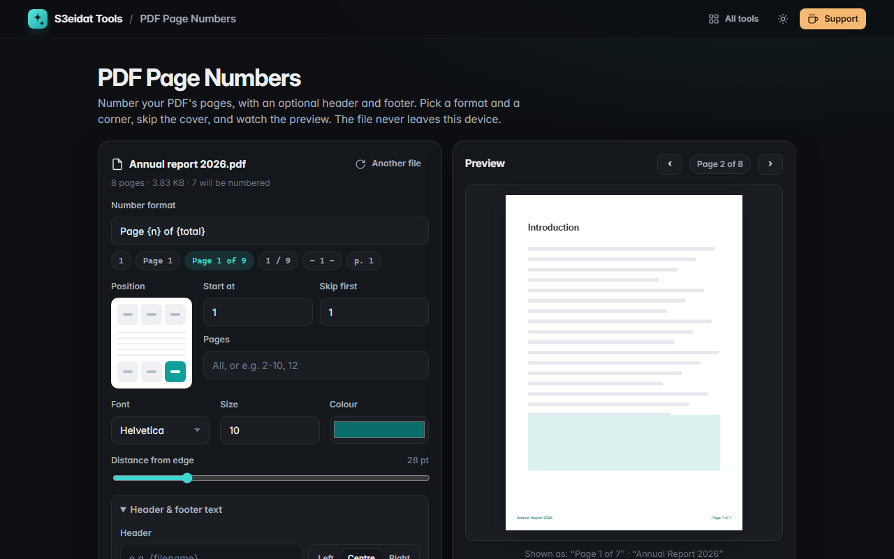

# PDF Page Numbers

> Add page numbers, headers and footers to a PDF, with a live preview. Free, private, and it runs entirely in your browser.

### ▶ [Open PDF Page Numbers](https://s3eidat.github.io/pdf-page-numbers/)



## Features

- Formats like `{n}`, `Page {n}`, `Page {n} of {total}`, `{n} / {total}`, `- {n} -`, or write your own
- **Six positions**: top or bottom, left, centre or right
- **Start number**, **skip the first pages** (a cover gets no number and isn't counted), and a **page range** like `2-10, 12`
- Font (Helvetica, Helvetica Bold, Times, Courier), size, colour and distance from the edge
- Optional **header and footer** text with `{n}`, `{total}`, `{date}` and `{filename}`
- **Live preview** of any page, showing exactly what will be added
- Numbers land in the right place on **rotated** and **odd-sized** pages, and are real, searchable PDF text
- Settings are remembered in your browser

## Limits

- Text the standard PDF fonts can't draw (Arabic, for example) in a header or footer is added as a sharp image instead of text.
- Password-protected PDFs need their protection removed first.

## Privacy

Your PDF never leaves your device. There is no server, no account, no analytics.
The page ships with a strict Content-Security-Policy (`connect-src 'self'`), so the browser
itself blocks any attempt to send data anywhere. Numbers are added with [pdf-lib](https://github.com/Hopding/pdf-lib) (MIT)
and previewed with [pdf.js](https://github.com/mozilla/pdf.js) (Apache-2.0), both included in `lib/`.

## Run it yourself

It's plain HTML, CSS and JavaScript with no build step:

```bash
git clone https://github.com/s3eidat/pdf-page-numbers
cd pdf-page-numbers
python -m http.server 8000
```

Then open http://localhost:8000.

## Support

If this saved you time, **[buy me a coffee ☕](https://s3eidat.github.io/coffee/)**. It keeps every tool free.

---

Part of **[S3eidat Tools](https://s3eidat.github.io/)**: 100+ free, private tools that run in your browser. MIT licensed.
